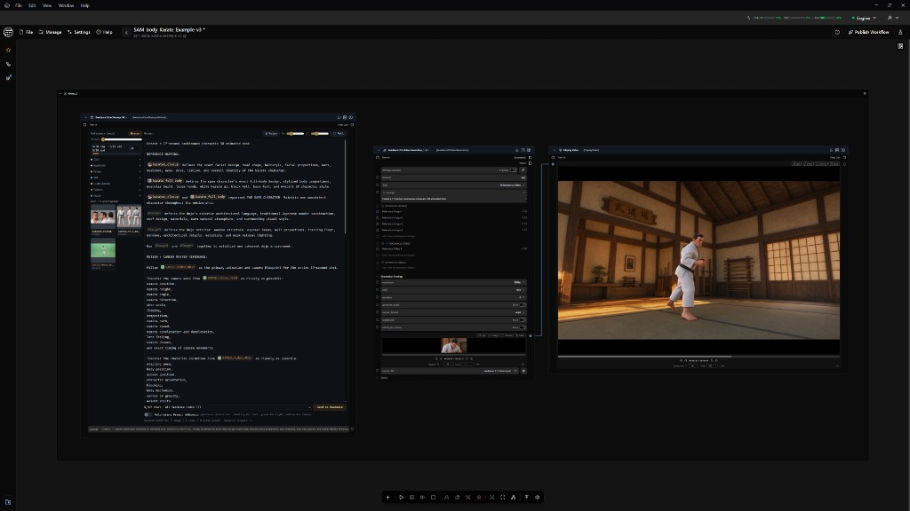

# GTN Shot Planner

Two prompt composers for [Griptape Nodes](https://www.griptapenodes.com/). Mention imported media with `@` tags, then push the prompt and the ordered references straight into the generator. No wires.

## Seedance Omni Prompt V9

One board for Seedance 2.0 and Seedance 2.5. It scans the workflow for imported images, video, and audio, groups them into named entities on production lanes, and **Send to Seedance** writes the bracket prompt plus the references into the target nodes.

- Seedance 2.5: 30 images / 10 videos / 10 audio, written into the reference lists.
- Seedance 2.0: 9 images / 3 videos / 3 audio. The node switches to Multimodal References, and videos land in `reference_video_1` through `reference_video_3`.
- The meter follows the selected target. Over budget, nice-to-have entities drop first and the pushed prompt is renumbered to match the files that node actually received.

## Image Omni Prompt

The same mention workflow for image generation. It scans imported images, and **Send to Image Gen** writes the prompt and only the mentioned images into every selected Google Nano Banana, OpenAI GPT Image, or ByteDance Seedream node.

## Install

Register `shot_planner_nodes/griptape_nodes_library.json` in Griptape Nodes → Settings → Libraries. The library name is **GTN Shot Planner**.
